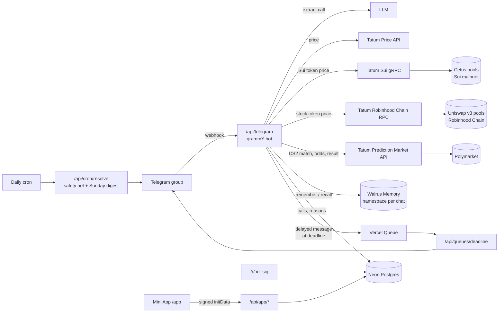

# MyKoll

[](https://github.com/stkalper/MyKoll/actions/workflows/ci.yml)

**Your group chat finally keeps receipts.** MyKoll is a Telegram bot for group chats that argue about crypto and Counter-Strike 2. When someone makes a call (“SUI to $5 by Friday”, “NaVi take FaZe tonight”), the bot logs it with the price at that second. It settles the call by itself at the deadline and remembers it in the chat’s **Walrus Memory**. So months later anyone can ask *“what did Ivan say about SUI?”* and get Ivan’s own words back.

- **Bot:** [@mykoll_bot](https://t.me/mykoll_bot). Add it to a group.
- **Site:** https://mykoll.vercel.app (the landing page with a live demo of the Mini App)
- **Live integration status:** https://mykoll.vercel.app/api/health
- **Tests:** `npm test` covers call spotting, price levels, CS2 team matching and match times, the learning loop, habits and pool pricing; CI runs lint, typecheck, tests and a build on every push.

Built for the **Tatum × Walrus “Total Recall”** hackathon, track *Markets & Sports Prediction*.


## Why

Every crypto or esports chat has the same fight: *“you said it would pump!”*, *“I never said that.”* Calls get made in passing, deleted, edited or forgotten, and nobody keeps score. MyKoll keeps score without changing how people talk. People just chat, and the bot remembers.

## How it works

1. **Someone makes a call** in a normal message or with `/call`. An LLM decides whether it is a checkable prediction and pulls out the asset, direction, target and deadline. It understands relative times (“in 2 hours”, “через 5 годин”) and day names (“by Friday” means the end of Friday). It works in English, Ukrainian, Russian and other languages. See [what counts as a call](#what-counts-as-a-call).
2. **The bot keeps the receipt.** It stores who said it, the exact words, when, and the price at that moment, all from Tatum. In *ask* mode the author taps “Log it” first. In *auto* mode it is logged straight away, and the author can undo it.
3. **The author can add the why** by replying to the receipt or with `/why`.
4. **At the deadline the bot posts first.** It shows ✅ or ❌, the final price and the author’s reasoning, plus a link to a public card that can be shared.
5. **Ask anything later.** Use `/ask` or mention the bot, and it answers from the chat’s memory, quoting people.
6. **Every Sunday** the bot posts the week’s digest: sharpest caller, best call and biggest miss.

### What counts as a call

People don’t write calls in a format, so the bot reads them the way they are said:

| In the chat | What the bot files |
|---|---|
| `SUI to $5 by Friday` | SUI above $5.00, judged at the end of Friday |
| `BTC 102k tomorrow` | No side said, so it compares with the price now: BTC at $76,900 makes it a call for **up** (above $102,000) |
| `СУІ вище 1 бакса через 5 годин` | SUI above $1.00, judged in exactly five hours |
| `TRX long from 0.34, TP 0.37. Broke daily resistance on volume` | A trading signal: TRX above the first take-profit. The reasoning is filed as the call’s *why* |
| `NaVi take FaZe tonight` · `Spirit beat Vitality` | A pick on the coming match |
| `easy for Vitality` · `изи для НАВІ завтра` | No opponent named: the bot looks up the team’s next match on Polymarket (on the day named, if any) |
| `FaZe 2-0 G2` · `ставлю на віталіті проти мауз` · `+1 FURIA` | A predicted score or betting slang is a pick on the winner |
| `bcgame ez` while the match is on | The match being played counts, at Polymarket’s live odds |
| `NaVi, Vitality, FURIA, fnatic` | **Several picks at once** (see below) |
| `https://x.com/cryptoguru/status/…` · `https://t.me/channel/123` · a post forwarded from a channel | **A call from a post** (see below) |
| `COIN: $SOL/USDT · SHORT · Targets: 180 / 175 / 168 · SL: 192` | A signal post: SOL below the first target |
| `$SUI 2x incoming` · `$CHZUSDT 4h: long bias, targets 0.0143` | A relative target becomes a level from the price when logged (SUI up 100%); a chart timeframe sets the horizon (4h: 3 days, 1D: 2 weeks, 1W: 2 months) |
| `Pick: Vitality ML @1.85 (2u)` | A tipster pick on Vitality; totals like `over 26.5 rounds` can't be checked |

Left alone: questions, jokes, other people’s predictions, vague moods (“sol looks good”) and talk about matches already played (“did you see NaVi beat FaZe yesterday?”). From signal channels, also: results and bragging (“Target 3: HIT ✅ (+64% gain)”), scenarios on both sides (“hold 76.5k and it pushes to 80.7k, lose it and it drops to 75k”) and pure conditionals (“a close above 82,150 opens the door to 87.5k”). These rules come from reading real posts in public signal channels, and each one is checked against them.

**Several picks in one message.** A list of teams becomes one pick per team, each on that team’s next match. The bot always asks first, whatever the chat’s mode, and lists what it left out: a team with no match this week, a repeat, or two teams that play each other. One tap logs them all as separate calls. Their results aren’t posted one by one: when the last match ends, one message lists every winner and the author’s score, with any upset the market didn’t see coming.
```
🏁 All matches are over · @ivan went 3/4
“NaVi, Vitality, FURIA, fnatic”

✅ #31 NaVi beat FaZe
✅ #32 Vitality beat MOUZ
❌ #33 Nemiga beat FURIA
✅ #34 fnatic beat Eternal Fire 🎯 upset, Polymarket had 38%
```

**Calls from posts on X and Telegram.** Chats argue about what someone posted as much as about their own takes. Share a link to a post on X or in a public Telegram channel, or forward the post into the group, and the bot reads it (X through the public fxtwitter API with vxtwitter as a fallback, Telegram through the channel’s embed widget; no API keys), finds the call in it, and asks the member who shared it whether to keep score. The call is filed under the post’s author (`@cryptoguru on X`), so outside accounts build a track record in the chat like members do and show up on the board. Times are read from when the post went up, so “by Friday” in a Wednesday post means that Friday; if the deadline has already passed, the bot says so instead of filing it. The price is taken when the link is shared, and the receipt links the original post and names who shared it. The member who shared it can hide or undo it, and it doesn’t count toward their own habits.

**The prompt only carries what a message needs.** The free LLM tier counts input tokens per minute, so the rules for signal posts and for CS2 picks are added only when a message looks like one, and a 429 waits as long as the provider asks before trying again.

**A cheap filter goes first.** Most chat messages never reach the LLM: a regex looks for a coin or a team next to a prediction word, a number or a list of teams. Beyond its fixed list of teams, it knows every team on Polymarket’s current CS2 matches, refreshed every 10 minutes, so “easy for bcgame” isn’t dropped. Those team names are passed to the LLM too, so “BC.Game” reads as a team, not a casino.

Code: [`src/lib/calls.ts`](src/lib/calls.ts). Try it: [`scripts/try-extract.mts`](scripts/try-extract.mts) runs sample messages through the filter and the LLM.

<p>
  
  
</p>

## Walrus Memory: why the bot needs a memory

Without memory, MyKoll is just a price alert. The product is the memory: *who said what, when, why, and how it ended*.

- **Each chat owns its memory.** Every group has its own namespace, `receipts:chat:<chatId>`, so one chat’s calls never come up in another chat’s answers.
- **Plain-language entries, recalled by meaning.** Each call writes up to three memories:
  ```
  [CALL #142] Thursday 30 Oct, 14:02: @ivan called "WAL to 5 cents by Friday". Logged as WAL above $0.0500 by Friday 31 Oct, 23:59. WAL was $0.0341 at the time (on-chain Cetus pool via Tatum Sui RPC).
  [REASON #142] @ivan explained the call: storage usage keeps climbing, chart is coiling
  [RESULT #142] @ivan's call "WAL to 5 cents by Friday" was WRONG: WAL was $0.0362 at the deadline.
  ```
  `/ask who was bullish on Sui coins?` finds Ivan’s WAL call even though the word “bullish” is never in it.
- **People control what is remembered.** This follows the Walrus team’s guidance on long-term memory management:
  - Only calls are stored, never the rest of the chat. When someone says a message wasn’t a call, only the bot’s own misreading is kept.
  - The author can **undo** an auto-logged message within 15 minutes.
  - The author can **hide** any call with `/hide`, or from the Mini App’s “What I remember about you” screen. Hidden calls drop off the board, the share links and the bot’s answers. Recall results are filtered by call id.
  - Reasons can be added later, so old memories gain context instead of going stale.

Code: [`src/lib/memory.ts`](src/lib/memory.ts), [`src/lib/ask.ts`](src/lib/ask.ts), [`src/lib/calls.ts`](src/lib/calls.ts).

## The learning loop: memory that changes what the bot does

Every settled call and every tap on a spotted call teaches the bot something, and the next message is handled differently because of it.

- **Where each member is right.** Each verdict recomputes the author’s track record by kind of call: per coin or team, Sui tokens vs majors, bullish vs bearish, short vs long range. New calls come back with that record, a warning when the call is in a known weak spot (or a 🔥 for a strong one), and the author’s most similar past call, recalled by meaning.
  ```
  📊 @ivan's record: WAL calls 0/2 · Sui tokens 1/4 · bullish calls 2/6 — ⚠️ a weak spot (Sui tokens 1/4)
  ↩ Last time: “WAL to 5 cents by Friday” — ❌ wrong
  ```
- **Whom to trust.** When others already have an open call on the same coin or match, the bot weighs everyone by their record on that kind of call, so a head count can lose to the people who are usually right:
  ```
  🧭 Also on SUI: @ivan ↓ down (0/3 on SUI calls), @max ↑ up (3/3 on SUI calls)
  2 of 3 say ↓ down, but weighted by track record the chat leans ↑ up (53%).
  ```
- **How each member talks.** Answers to spotted calls change how the bot treats that person:
  - **Confirms:** after 3 confirmed calls in a row, it logs theirs without asking, and says why.
  - **Rejects:** when 2 of the last 3 spotted calls were rejected, it asks first, even in auto mode.
  - **Misreads:** when the author says “not a call”, the bot writes its own misreading to Walrus Memory. A later message that reads the same way (same coin, same direction) is offered with a note instead of logged, and after two rejections it stays quiet. The misreading is stored, never the message.
- **The history is in Walrus Memory**, next to the calls, so `/ask` can explain how the bot’s view of someone changed:
  ```
  [TRACK RECORD @ivan] 2026-10-31, after call #142: @ivan is 1/4 right; weak on Sui tokens 1/4.
  [HABIT @max] Friday 31 Oct, 18:40: @max confirmed their last 3 calls, so I log theirs without asking.
  [NOT A CALL] @ola: I read a message as "BTC below $90,000" (BTC, bearish) and they said it wasn't a call.
  ```
- **The Mini App shows each member what was learned about them:** their record card, strong and weak spots, and how the bot now handles their calls.

Code: [`src/lib/learning.ts`](src/lib/learning.ts), [`src/lib/habits.ts`](src/lib/habits.ts). Try it without Telegram: [`scripts/try-learning.mts`](scripts/try-learning.mts), [`scripts/try-habits.mts`](scripts/try-habits.mts).

## Tatum: prices you can check

Every crypto call is judged by a price from Tatum, and each receipt records which source judged it.

| Asset | Source | How |
|---|---|---|
| BTC, ETH, SOL and other majors | **Tatum Price API** | `GET /v4/data/rate/symbol` |
| SUI, WAL, DEEP, CETUS, HAEDAL, NAVX, NS, IKA, HIPPO, SCA, LOFI | **Tatum Sui RPC (gRPC)** | Reads the token’s deepest **Cetus CLMM pool on Sui mainnet** and converts `current_sqrt_price` (Q64.64) to USD |
| Stock tokens TSLA, NVDA, AAPL, SPY, MSFT, AMZN, GOOGL, META, COIN; memecoins PONS, CASHCAT | **Tatum Robinhood Chain RPC** | Reads the token’s deepest **Uniswap v3 pool on Robinhood Chain**, quoted in USDG or via WETH/USDG, and converts `sqrtPriceX96` (Q64.96) to USD |

Why on-chain matters: on our plan the Price API covers SUI but answers `402` for WAL, DEEP, NS, HIPPO and the other Sui tokens. For the tokens a Sui chat actually talks about, the pool on Sui is the only price there is.

**Robinhood Chain, read with the free plan.** Robinhood’s stock tokens and the chain’s memecoins trade only in its DEX pools, so the pool is the price. The free plan has no `eth_call` and no batching, so the bot reads each pool’s raw `slot0` storage with `eth_getStorageAt` (its low 160 bits are `sqrtPriceX96`), all at one block it fetched first, so the price and its proof describe the same moment. Copycat tokens reuse tickers there (a second “NVDA” trades at $0.0007), so pools are pinned, each checked against market prices by [`scripts/try-robinhood.mts`](scripts/try-robinhood.mts). Receipts keep the pool and block and link the pool on Blockscout.

**Every on-chain price can be checked.** The bot reads each pool together with the transaction that last changed it, which is the transaction that set the price. The receipt keeps that digest for the price at logging and the price at the deadline. In the chat a **🔎 Check the price on Sui** button opens it on Suiscan, and the Mini App and share pages link to it too. For a token quoted in SUI, both pool reads are kept (token/SUI and SUI/USDC).

**Two sources, compared.** When the Price API also covers a token (SUI), the bot asks both and shows how far apart they are. Above 2% the receipt flags it, and the on-chain price is the one that counts:
```
SUI was $0.9519 when called · on-chain Cetus pool via Tatum Sui RPC
✓ Tatum Price API agrees: $0.9535 (0.2% apart)
```
Both go into Walrus Memory with the call (`… pool state from Sui tx 4stnGpxc…; Tatum Price API said $0.9535`), so `/ask` can say where a verdict came from.

Notes from building it:

- **Tatum’s Sui JSON-RPC reached end of life** (it returns 404 now), so the bot uses `sui-mainnet-grpc.gateway.tatum.io`.
- **The gateway speaks native gRPC, not gRPC-web,** so `SuiGrpcClient` from `@mysten/sui` runs over `@protobuf-ts/grpc-transport` and `@grpc/grpc-js`, with the API key in metadata.
- **Requests are throttled and retried on 429**, and pool reads are cached for 20 s, so the bot stays inside the free plan’s rate limit.

Code: [`src/lib/suiPrices.ts`](src/lib/suiPrices.ts), [`src/lib/robinhoodPrices.ts`](src/lib/robinhoodPrices.ts), [`src/lib/tatum.ts`](src/lib/tatum.ts). Checks: [`scripts/try-prices.mts`](scripts/try-prices.mts) prints each price with its source, cross-check and explorer link; [`scripts/try-settle.mts`](scripts/try-settle.mts) logs and settles a call end to end.

### CS2 against the market: Tatum Prediction Market API

A CS2 call is matched to the **Polymarket match-winner market** for the same two teams, through Tatum’s Prediction Market API (`/v4/data/prediction`). Team names are compared exactly after normalising (“Team Vitality” = “VITALITY”, “Natus Vincere” = “NaVi”, but “NAVI Junior” is not NaVi).

- **The receipt shows the market’s view:** `📈 Polymarket gave FURIA 43% when called — an underdog pick`, with a button to the market. A match already being played can be called too, at the live price Polymarket trades it at. A pick the market already prices at 97%+ is refused: that match is decided.
- **Only a team named? It finds the match.** “easy for Vitality” goes on Vitality’s next match, or the one being played right now. The bot merges Polymarket’s newest CS2 listings with a search by team name, because search returns only ten results and the newest-first listing misses matches put up days ahead.
- **Match times come from the description.** An event’s `closeTime` is a few hours after the market went up, not the match, and CS2 markets keep trading during play, so neither says when a match starts. The start is read from the event text instead (“initially scheduled for October 30, 2026 at 5:15 PM ET”, converted from New York time).
- **The call settles from Polymarket’s resolution** (Polymarket resolves CS2 from HLTV) the moment it resolves, so nobody has to confirm the score. Until then, the chat’s one-tap confirmation still works.
- **The bot learns who beats the market.** Picks are filed as *underdog picks* (under 45%) or *favourite picks* (over 55%), and each member’s record gets an edge against the market: their hit rate minus the average price Polymarket gave their picks (`beats Polymarket by 12 pts on CS2`). A win the market had under 45% comes back as `🎯 Called the upset`.

Code: [`src/lib/polymarket.ts`](src/lib/polymarket.ts). Checks: [`scripts/try-polymarket.mts`](scripts/try-polymarket.mts) maps calls to upcoming matches; [`scripts/try-cs2.mts`](scripts/try-cs2.mts) logs a call with its odds and settles one from a played match.

## Commands

| Command | What it does |
|---|---|
| `/call SUI to $5 by Friday` | Log a call (or just say it in the chat); `/call <link to a post>` files the call in that post |
| `/why 12 ETF inflows` | Add your reasoning to call #12 (or reply to its receipt) |
| `/ask what did Max say about SOL?` | Answer from the chat’s memory (or mention the bot) |
| `/board` | Leaderboard, plus a button that opens the Mini App |
| `/open` | Calls still waiting for their deadline |
| `/hide 12` | Take your call off the board and out of the bot’s answers |
| `/mode` | Admins choose *ask first* or *auto* logging |

CS2 calls settle from Polymarket when the match is listed there (see below); otherwise, or until Polymarket resolves it, someone other than the author confirms the winner with one tap.

## Architecture



- **Next.js 16** on Vercel serves the landing page, the Mini App, the bot webhook, public receipt pages and their Open Graph images.
- **Calls settle on time with no polling.** Logging a call publishes a delayed Vercel Queue message for its deadline. Vercel’s free plan only allows daily cron jobs, so the cron is just a safety net and runs the Sunday digest.
- **Neon Postgres** stores the structured side: calls, reasons, votes, sets of picks and chat settings. **Walrus Memory** holds what the bot remembers and answers from.
- **The Mini App** checks Telegram’s signed `initData` and asks Telegram whether the viewer is a member before it shows a group.
- **Public receipt links** are signed with HMAC, so receipts can’t be enumerated by id.

## Built during Total Recall

The whole project was built during the hackathon window, from 28 October 2026 onward. A few helpers were adapted from the author’s earlier Walrus project, Thesis Keeper: the OpenAI-compatible LLM call, Telegram `initData` validation and the MemWal wrapper pattern. The commit history shows the progress.

## Run it yourself

```bash
npm install
cp .env.example .env.local   # fill in the keys
npx tsx --env-file=.env.local scripts/check-tatum.mjs    # Tatum Price API + Sui gRPC
npx tsx --env-file=.env.local scripts/check-memwal.mts   # Walrus Memory delegate key
npx tsx --env-file=.env.local scripts/poll.mts           # run the bot locally (long polling)
npm run dev                                              # landing + Mini App on :3000
```

Without `DATABASE_URL` the app uses an embedded PGlite database in `.data/`, so local development needs no Postgres.

In production the bot runs on a webhook: `setWebhook` to `<PUBLIC_URL>/api/telegram` with `TELEGRAM_WEBHOOK_SECRET`. Telegram groups need the bot’s privacy mode turned off in BotFather so it can see ordinary messages. The Mini App URL is `<PUBLIC_URL>/app`.

## Hackathon details

- **Walrus Memory agent ID:** `3f039bd7212a0e4c5fddb2db0bfda379af0624b36a7456cedd7e88b148aa8c28`
- **Network:** Walrus Memory on mainnet (`relayer.memory.walrus.xyz`), Sui mainnet via Tatum
