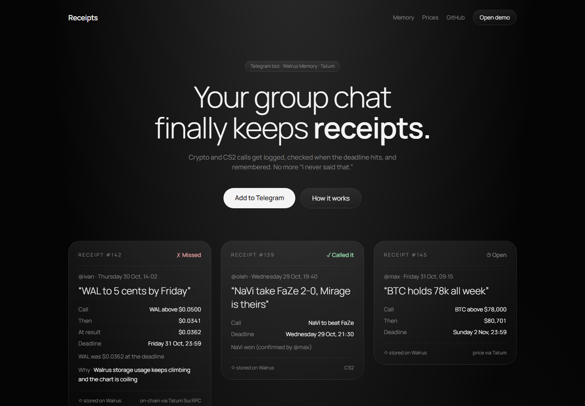
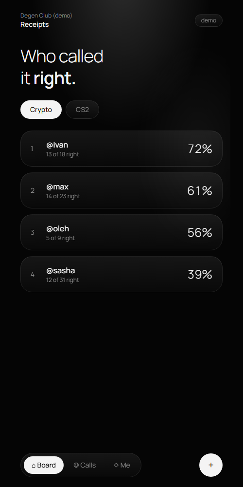
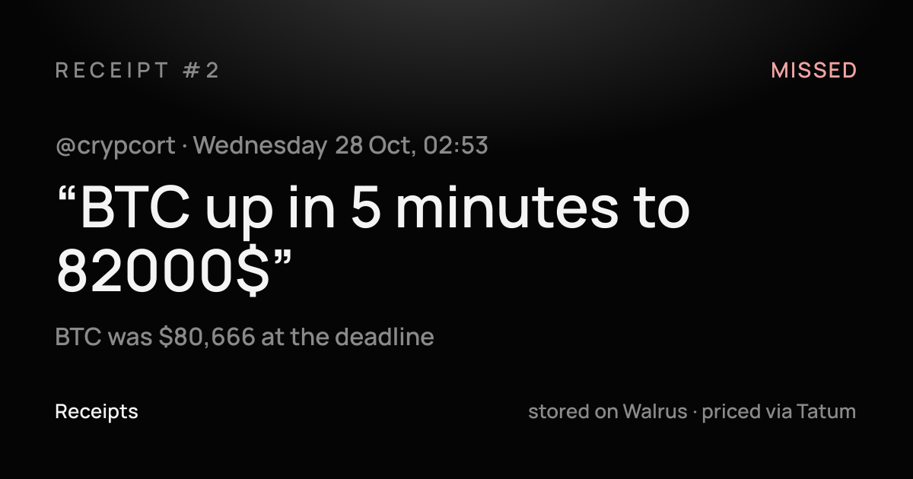
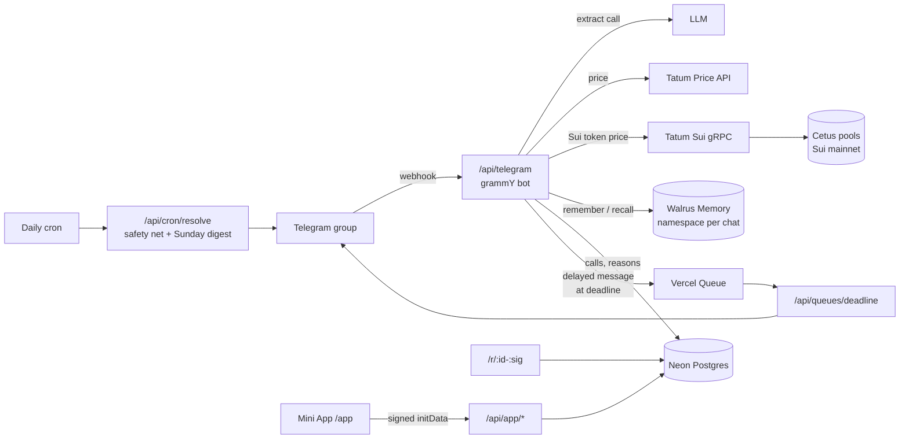

# Receipts

**Your group chat finally keeps receipts.** Receipts is a Telegram bot for group chats that argue about crypto and Counter-Strike 2. When someone makes a call (“SUI to $5 by Friday”, “NaVi take FaZe tonight”), the bot logs it with the price at that second. It settles the call by itself at the deadline and remembers it in the chat’s **Walrus Memory**. So months later anyone can ask *“what did Ivan say about SUI?”* and get Ivan’s own words back.

- **Bot:** [@mykoll_bot](https://t.me/mykoll_bot). Add it to a group.
- **Site:** https://receipts-flame.vercel.app (the landing page with a live demo of the Mini App)
- **Live integration status:** https://receipts-flame.vercel.app/api/health

Built for the **Tatum × Walrus “Total Recall”** hackathon, track *Markets & Sports Prediction*.



## Why

Every crypto or esports chat has the same fight: *“you said it would pump!”*, *“I never said that.”* Calls get made in passing, deleted, edited or forgotten, and nobody keeps score. Receipts keeps score without changing how people talk. People just chat, and the bot remembers.

## How it works

1. **Someone makes a call** in a normal message or with `/call`. An LLM decides whether it is a checkable prediction and pulls out the asset, direction, target and deadline. It understands relative times (“in 2 hours”) and day names (“by Friday” means the end of Friday). It works in English, Ukrainian, Russian and other languages.
2. **The bot keeps the receipt.** It stores who said it, the exact words, when, and the price at that moment, all from Tatum. In *ask* mode the author taps “Log it” first. In *auto* mode it is logged straight away, and the author can undo it.
3. **The author can add the why** by replying to the receipt or with `/why`.
4. **At the deadline the bot posts first.** It shows ✅ or ❌, the final price and the author’s reasoning, plus a link to a public card that can be shared.
5. **Ask anything later.** Use `/ask` or mention the bot, and it answers from the chat’s memory, quoting people.
6. **Every Sunday** the bot posts the week’s digest: sharpest caller, best call and biggest miss.

<p>
  
  
</p>

## Walrus Memory: why the bot needs a memory

Without memory, Receipts is just a price alert. The product is the memory: *who said what, when, why, and how it ended*.

- **Each chat owns its memory.** Every group has its own namespace, `receipts:chat:<chatId>`, so one chat’s calls never come up in another chat’s answers.
- **Plain-language entries, recalled by meaning.** Each call writes up to three memories:
  ```
  [CALL #142] Thursday 30 Oct, 14:02: @ivan called "WAL to 5 cents by Friday". Logged as WAL above $0.0500 by Friday 31 Oct, 23:59. WAL was $0.0341 at the time (on-chain Cetus pool via Tatum Sui RPC).
  [REASON #142] @ivan explained the call: storage usage keeps climbing, chart is coiling
  [RESULT #142] @ivan's call "WAL to 5 cents by Friday" was WRONG: WAL was $0.0362 at the deadline.
  ```
  `/ask who was bullish on Sui coins?` finds Ivan’s WAL call even though the word “bullish” is never in it.
- **People control what is remembered.** This follows the Walrus team’s guidance on long-term memory management:
  - Only calls are stored, never the rest of the chat.
  - The author can **undo** an auto-logged message within 15 minutes.
  - The author can **hide** any call with `/hide`, or from the Mini App’s “What I remember about you” screen. Hidden calls drop off the board, the share links and the bot’s answers. Recall results are filtered by call id.
  - Reasons can be added later, so old memories gain context instead of going stale.

Code: [`src/lib/memory.ts`](src/lib/memory.ts), [`src/lib/ask.ts`](src/lib/ask.ts), [`src/lib/calls.ts`](src/lib/calls.ts).

## Tatum: prices you can check

Every crypto call is judged by a price from Tatum, and each receipt records which source judged it.

| Asset | Source | How |
|---|---|---|
| BTC, ETH, SOL and other majors | **Tatum Price API** | `GET /v4/data/rate/symbol` |
| SUI, WAL, DEEP, CETUS, HAEDAL, NAVX, NS, IKA, HIPPO, SCA, LOFI | **Tatum Sui RPC (gRPC)** | Reads the token’s deepest **Cetus CLMM pool on Sui mainnet** and converts `current_sqrt_price` (Q64.64) to USD |

Why on-chain matters: the Price API returns nothing for WAL, DEEP, NS or HIPPO. For the tokens a Sui chat actually talks about, the pool on Sui is the only honest price.

Notes from building it:

- **Tatum’s Sui JSON-RPC reached end of life** (it returns 404 now), so the bot uses `sui-mainnet-grpc.gateway.tatum.io`.
- **The gateway speaks native gRPC, not gRPC-web,** so `SuiGrpcClient` from `@mysten/sui` runs over `@protobuf-ts/grpc-transport` and `@grpc/grpc-js`, with the API key in metadata.
- **Requests are throttled and retried on 429**, and pool reads are cached for 20 s, so the bot stays inside the free plan’s rate limit.

Code: [`src/lib/suiPrices.ts`](src/lib/suiPrices.ts), [`src/lib/tatum.ts`](src/lib/tatum.ts), [`scripts/check-tatum.mjs`](scripts/check-tatum.mjs).

## Commands

| Command | What it does |
|---|---|
| `/call SUI to $5 by Friday` | Log a call (or just say it in the chat) |
| `/why 12 ETF inflows` | Add your reasoning to call #12 (or reply to its receipt) |
| `/ask what did Max say about SOL?` | Answer from the chat’s memory (or mention the bot) |
| `/board` | Leaderboard, plus a button that opens the Mini App |
| `/open` | Calls still waiting for their deadline |
| `/hide 12` | Take your call off the board and out of the bot’s answers |
| `/mode` | Admins choose *ask first* or *auto* logging |

CS2 calls settle when someone other than the author confirms the winner with one tap.

## Architecture



- **Next.js 16** on Vercel serves the landing page, the Mini App, the bot webhook, public receipt pages and their Open Graph images.
- **Calls settle on time with no polling.** Logging a call publishes a delayed Vercel Queue message for its deadline. Vercel’s free plan only allows daily cron jobs, so the cron is just a safety net and runs the Sunday digest.
- **Neon Postgres** stores the structured side: calls, reasons, votes and chat settings. **Walrus Memory** holds what the bot remembers and answers from.
- **The Mini App** checks Telegram’s signed `initData` and asks Telegram whether the viewer is a member before it shows a group.
- **Public receipt links** are signed with HMAC, so receipts can’t be enumerated by id.

## Built during Total Recall

The whole project was built during the hackathon window, from 28 October 2026 onward. A few helpers were adapted from the author’s earlier Walrus project, Thesis Keeper: the OpenAI-compatible LLM call, Telegram `initData` validation and the MemWal wrapper pattern. The commit history shows the progress.

## Run it yourself

```bash
npm install
cp .env.example .env.local   # fill in the keys
npx tsx --env-file=.env.local scripts/check-tatum.mjs    # Tatum Price API + Sui gRPC
npx tsx --env-file=.env.local scripts/check-memwal.mts   # Walrus Memory delegate key
npx tsx --env-file=.env.local scripts/poll.mts           # run the bot locally (long polling)
npm run dev                                              # landing + Mini App on :3000
```

Without `DATABASE_URL` the app uses an embedded PGlite database in `.data/`, so local development needs no Postgres.

In production the bot runs on a webhook: `setWebhook` to `<PUBLIC_URL>/api/telegram` with `TELEGRAM_WEBHOOK_SECRET`. Telegram groups need the bot’s privacy mode turned off in BotFather so it can see ordinary messages. The Mini App URL is `<PUBLIC_URL>/app`.

## Hackathon details

- **Walrus Memory agent ID:** `3f039bd7212a0e4c5fddb2db0bfda379af0624b36a7456cedd7e88b148aa8c28`
- **Network:** Walrus Memory on mainnet (`relayer.memory.walrus.xyz`), Sui mainnet via Tatum
